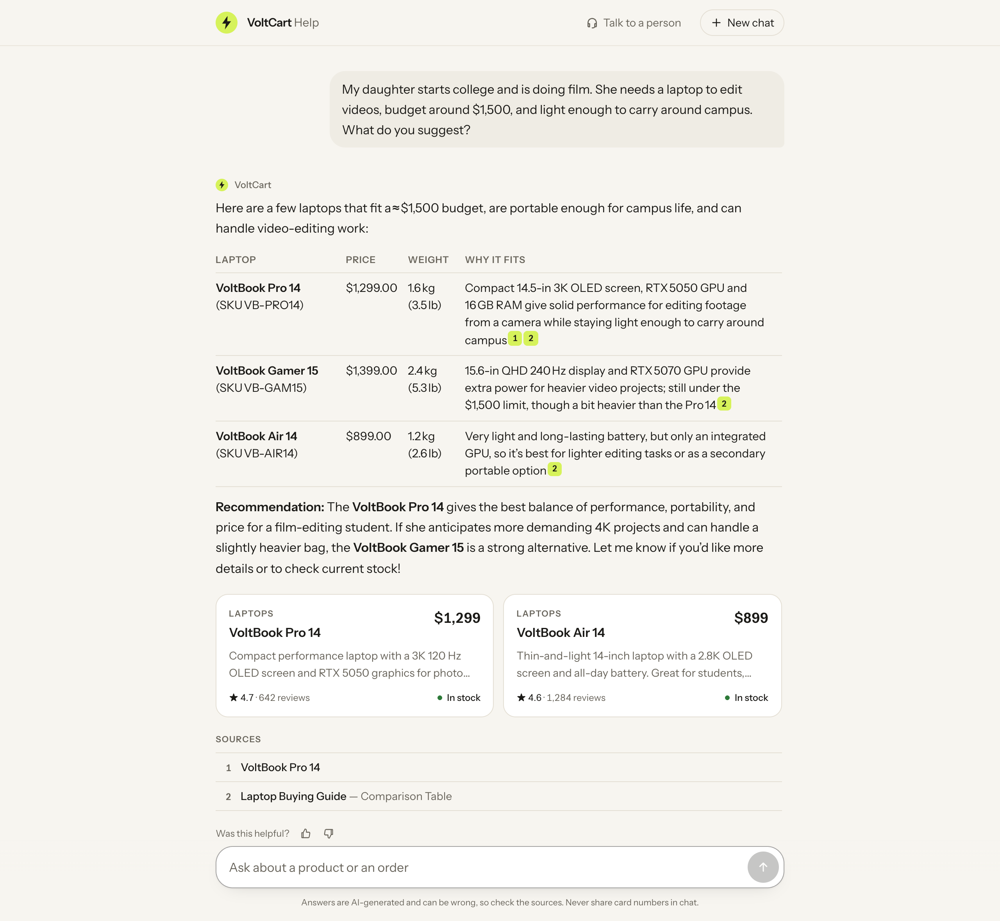
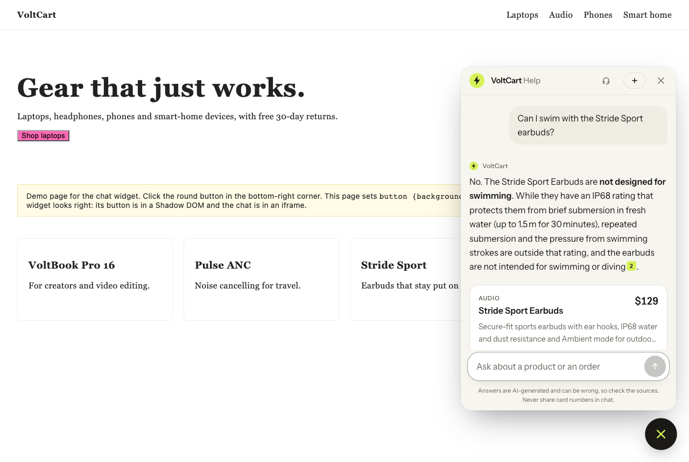
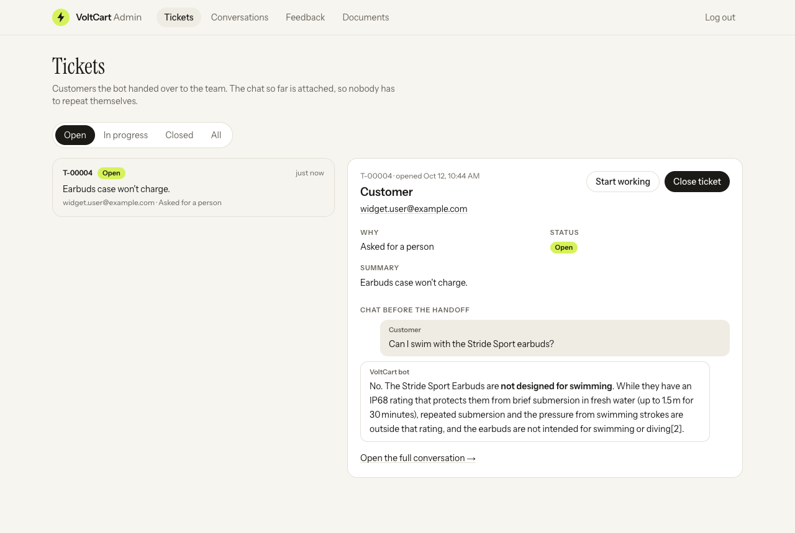
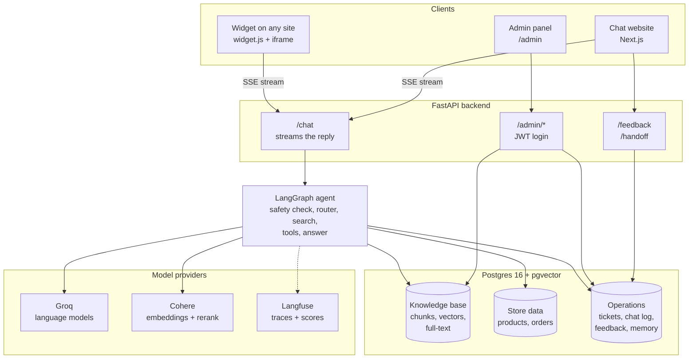
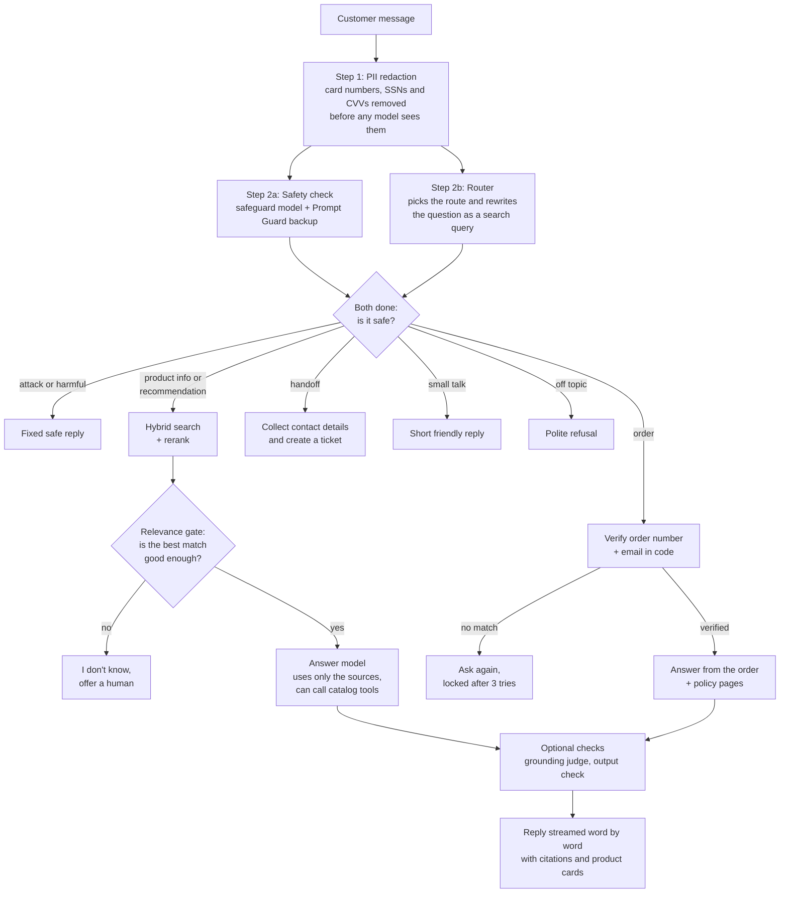
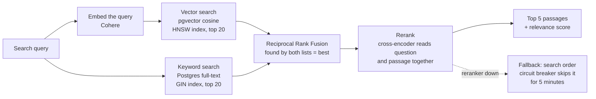
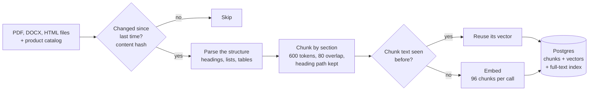

# VoltCart Assistant

A production-style **RAG customer-support chatbot** for VoltCart, a fictional electronics store. It helps shoppers choose the right product, answers store-policy questions with sources, looks up orders only after the customer proves who they are, and hands the conversation to a human when it can't help.

It runs entirely on **free tiers** (Groq for the language models, Cohere for embeddings and reranking), and every provider can be swapped in `.env`.



<table>
<tr>
<td width="50%"></td>
<td width="50%"></td>
</tr>
<tr>
<td align="center"><b>Embeddable widget</b> on any website, with one script tag</td>
<td align="center"><b>Admin panel</b>: tickets with the chat attached, conversations, feedback, documents</td>
</tr>
</table>

## What it does

| For | What happens |
|---|---|
| **Shoppers** | Ask "which laptop for video editing under $1,500?" and get a recommendation built from the manuals, buying guides and live catalog, with prices, stock, citations and product cards |
| **Policy questions** | Shipping, returns, warranty and payment are answered from the help center. If nothing relevant is found, the bot says so instead of guessing |
| **Orders** | Status only after the order number **and** its email match. The check happens in code, never by the LLM, and three wrong attempts lock the lookup |
| **Hard cases** | A human handoff creates a ticket with the conversation attached, from the chat or from a contact form |
| **Support team** | An admin panel for tickets, conversations, 👎 feedback, and uploading or deleting documents |

## What this project does better than a typical RAG chatbot

| Typical RAG demo | This project |
|---|---|
| Vector search only | **Hybrid search**: meaning-based (pgvector) plus keyword (Postgres full-text), merged with Reciprocal Rank Fusion, then **reranked** by a cross-encoder |
| Always answers, even from weak matches | A **relevance gate**: below a tuned score, the bot says "I don't know" and offers a human |
| Splits text every N characters | **Structure-aware parsing** of PDF, DOCX and HTML, with chunks that keep their section headings |
| Re-embeds everything on every update | **Incremental ingestion**: content hashes skip unchanged files and reuse unchanged chunks |
| Lets the model run SQL or see raw data | The model only calls **predefined tools**. Order data appears only after verification in code, and never includes other customers |
| One system prompt as the only safety | **Layered guardrails**: PII redaction, a safety classifier with a backup, prompt rules, verification in code, optional grounding and output checks, all **measured on an attack set** |
| "It looks good to me" | **Evals with quality gates**: retrieval, routing, guardrails, and an LLM judge scoring correctness and faithfulness against fixed targets |
| Breaks when a provider is down | **Resilience**: timeouts, retries, model fallbacks and a circuit breaker, so a dead reranker slows answers down instead of freezing them |
| A chat box | Streaming UI with citations and product cards, an isolated embeddable widget, an admin panel, tracing and feedback |

## How it is built

### System overview



### What happens to every chat message



Steps 2a and 2b run **in parallel**, so the safety check adds no waiting time. The conversation is saved after every step (LangGraph memory in Postgres), so follow-up questions like "how much is it?" work.

### How search finds the right passage



### How documents get into the knowledge base



Run it with `make ingest`, or upload a file in the admin panel: it becomes searchable as soon as the upload finishes. Deleting a document removes it from answers immediately.

## Evaluation results

The project is measured against fixed quality targets with its own eval suite: 122 golden questions written to cover edge cases (typos, follow-ups, false premises, calculations, another language, order security), plus 32 attack and look-alike messages. `make eval` runs everything and checks each target in [evals/thresholds.toml](evals/thresholds.toml).

| Metric | Result | Target |
|---|---|---|
| Retrieval hit rate @5 (hybrid + rerank) | **0.99** (MRR 0.93) | ≥ 0.85 |
| Answer correctness (LLM judge) | **0.85** | ≥ 0.80 |
| Faithfulness (claims supported by the sources) | **0.99** | ≥ 0.85 |
| Refusal accuracy (not in the docs, off topic) | **1.00** | ≥ 0.90 |
| Routing accuracy | **0.99** | ≥ 0.90 |
| Guardrails: attacks handled | **24 / 24** | ≥ 90% |
| Guardrails: harmless messages blocked | **0 / 8** | 0 |
| Data leaks | **0** | 0 |
| Order verification bypasses | **0** | 0 |

Answer quality was graded on a 40-question sample that covers all 9 question categories and all 35 edge-case types. The judge is a different model from the one that answers. On free-tier APIs, a full answer takes a few seconds to about 20 seconds, because providers limit tokens per minute; paid tiers remove that wait.

The evals also found real problems, which were fixed: a reranker call that could hang for 30 minutes, a router that called gaming questions off topic, and a refund calculation that missed a fee.

## Tech stack

| Layer | Choice |
|---|---|
| Language models | Groq: `gpt-oss-120b` (answers), a small model (routing), `gpt-oss-safeguard-20b` (safety), `gpt-oss-20b` (eval judge) |
| Embeddings + rerank | Cohere `embed-multilingual-v3.0`, `rerank-v3.5` |
| Agent | LangGraph + LangChain |
| Data | Postgres 16 + pgvector, SQLAlchemy, Alembic |
| API | FastAPI, Server-Sent Events, JWT admin login, rate limiting, JSON logs with request ids |
| UI | Next.js 16, React 19, Tailwind 4 |
| Observability | Langfuse (one trace per answer; 👍/👎 and eval grades recorded as scores) |
| Delivery | Docker Compose, GitHub Actions CI |
| Tooling | uv, Ruff, pytest (about 1,600 tests), Vitest |

## Quick start with Docker (one command)

**You need:** Docker Desktop, plus free API keys from [Groq](https://console.groq.com) and [Cohere](https://dashboard.cohere.com). [Langfuse](https://cloud.langfuse.com) is optional.

```bash
cp .env.example .env    # add GROQ_API_KEY, COHERE_API_KEY, ADMIN_PASSWORD, JWT_SECRET
make up                 # starts postgres + api + web
make docker-seed        # loads sample products, customers and orders
make docker-ingest      # embeds the 21 sample documents and the catalog (about 3 Cohere calls)
```

Then open:
- **Chat:** http://localhost:3000
- **Admin:** http://localhost:3000/admin (log in with `ADMIN_PASSWORD`)
- **API docs:** http://localhost:8000/docs

`make down` stops everything (your data is kept). `make docker-logs` shows the logs.

## Quick start for development (hot reload)

**You also need:** [uv](https://docs.astral.sh/uv/) and Node.js 20 or newer.

```bash
cp .env.example .env
make install            # Python packages
make db-up              # Postgres + pgvector on localhost:5433
make migrate            # create the tables
make seed               # sample store data
make ingest             # build the knowledge base
make web-install        # website packages

make api                # terminal 1: API on http://localhost:8000
make web                # terminal 2: website on http://localhost:3000
make widget-demo        # optional: a demo store page with the widget, http://127.0.0.1:8080
```

Run `make` commands from the project root and `uv` commands inside `backend/`. `make help` lists every command.

## Useful commands

| Command | What it does |
|---|---|
| `make chat args="--debug"` | Chat in the terminal and see the route, sources and scores |
| `make ask q="can I swim with the Stride?"` | Show only the search results for a question |
| `make preview f=sample_data/docs/shipping-policy.html` | Show how a file is split into chunks (no API calls) |
| `make test` / `make test-all` | Unit tests / all tests, including the database |
| `make web-test` | Website type check and unit tests |
| `make eval` | Run every eval and check the quality targets |
| `make eval-answers` | Grade answers with the judge (`args="--all"` for all 122 questions) |
| `make synthetic` | Draft new test questions from the documents, for review |
| `make lint` / `make format` | Check / fix code style |

## Add the widget to a website

```html
<script src="https://your-chat-site.example/widget.js" async></script>
```

The button lives in a Shadow DOM and the chat in an iframe, so the store's CSS and scripts can't break it or read it. Only the widget page may be framed by other sites; the chat page and admin refuse it, which blocks clickjacking.

## CI and deployment

- **CI** ([.github/workflows/ci.yml](.github/workflows/ci.yml)) runs on every push:
  - backend lint, then all tests on a fresh Postgres (no API keys needed)
  - website audit, type check, tests and build
  - a build of both Docker images
  - the evals run on demand from the Actions tab.
- **Deployment** ([docs/DEPLOY.md](docs/DEPLOY.md)): Neon (Postgres + pgvector), Render (API) and Vercel (website) on free tiers, or `make up` on a single server. It includes a checklist before real customers.

## Project layout

```
backend/
  app/
    api/          chat (streaming), feedback, handoff, admin, security (JWT, rate limits)
    graph/        LangGraph agent: graph, prompts, state, wiring
    retrieval/    vector + keyword search, fusion, reranker with fallback
    ingestion/    PDF/DOCX/HTML loaders, chunking, incremental pipeline
    guardrails/   PII redaction, safety classifier, grounding judge
    tools/        product search, verified order lookup, tickets
    db/           models and sessions
  alembic/        database migrations
  scripts/        ingest, chat, ask, seed, evals
  tests/          about 1,600 tests
frontend/         Next.js: chat (/), widget (/widget + public/widget.js), admin (/admin)
sample_data/      VoltCart documents, catalog, customers, orders, widget demo page
evals/            golden and attack datasets, thresholds, reports
docs/             deployment guide and README images
.github/          CI workflow
```

## Docs

- [docs/DEPLOY.md](docs/DEPLOY.md): deployment guide and checklist before real customers
- [evals/datasets/README.md](evals/datasets/README.md): how the test sets and grading work

## Security

- **Secrets:** they live only in `.env`, which git ignores. The browser never receives an API key.
- **Data access:** the LLM never writes SQL. It can only call predefined tools, and order data is released only after verification in code.
- **Sessions and admin:** session ids are random and made by the server. Admin routes need a signed, expiring token.
- **Rate limits:** chat and login are rate-limited, and visitor IPs are read safely behind proxies.
- **Uploads:** files get safe names, are parsed before they're accepted, and are size-limited.
- **Containers:** they run as a non-root user.
